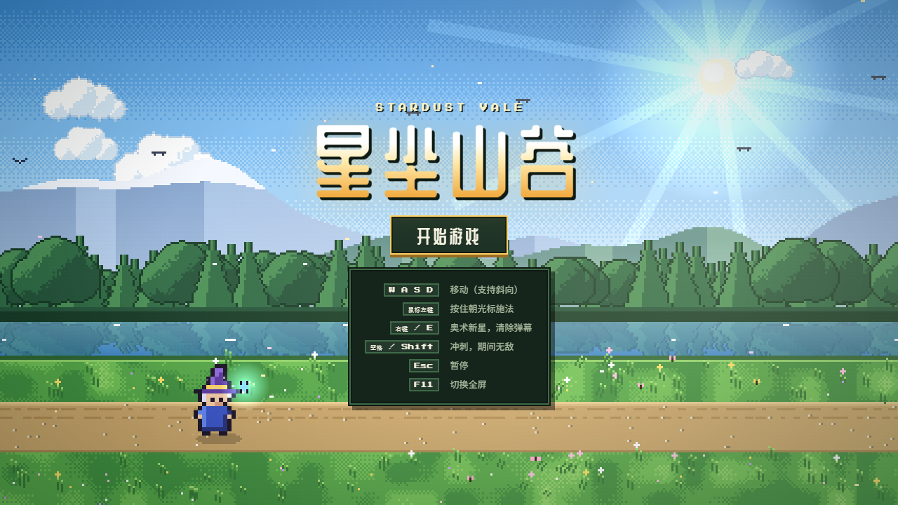
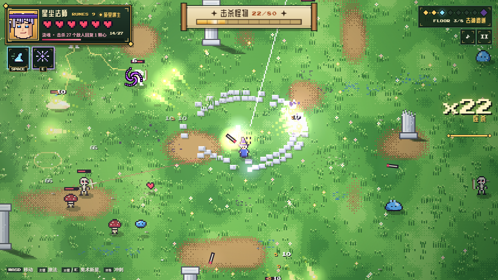
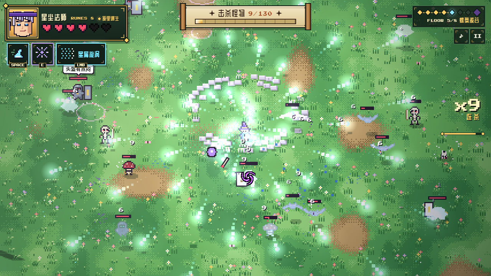
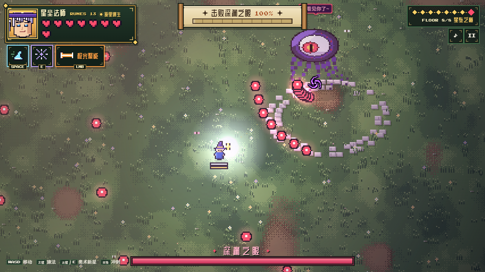
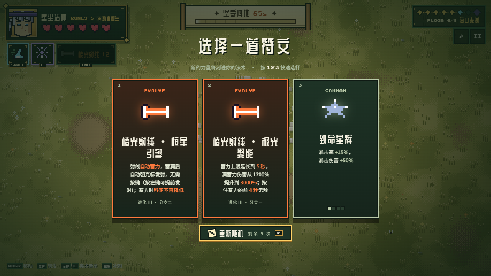
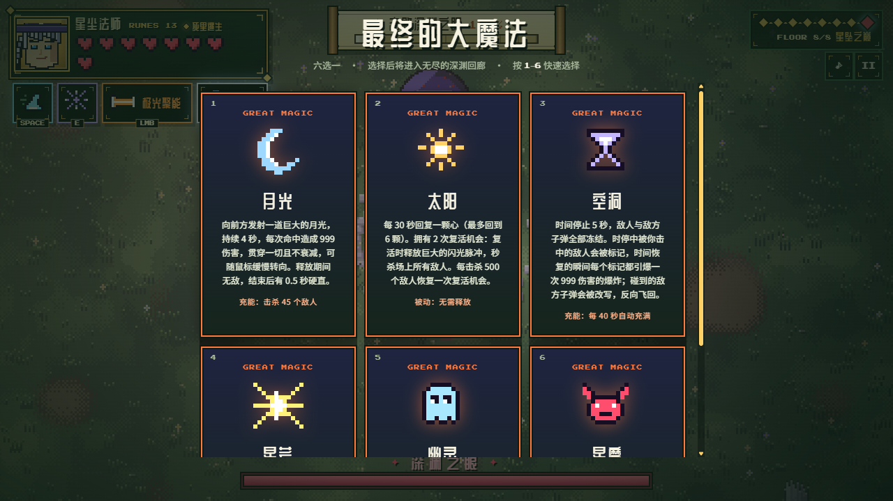
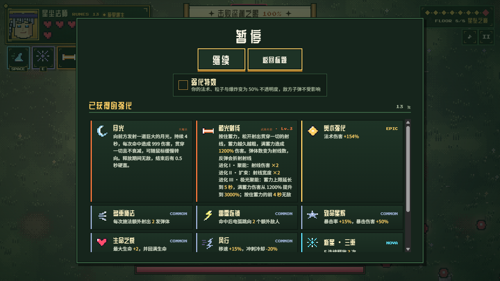
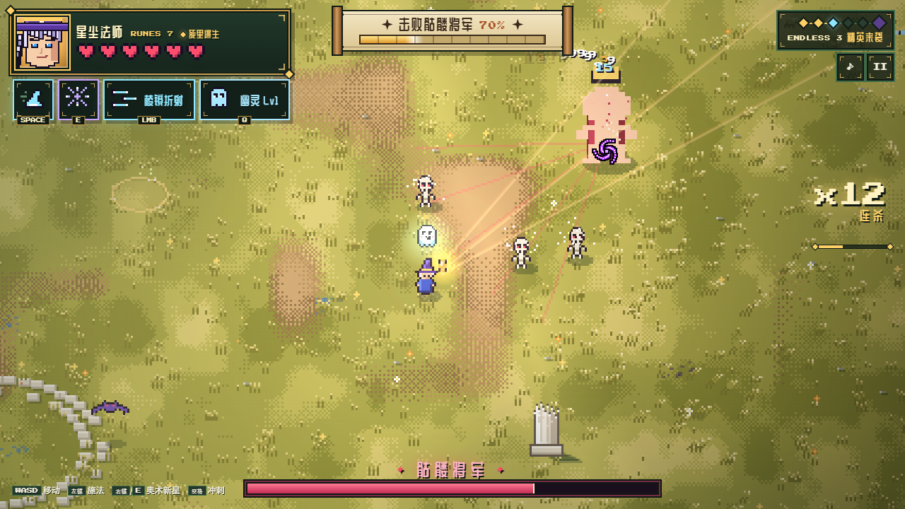

<h1 align="center">星尘山谷 · Stardust Vale</h1>

<p align="center">
  一款像素风 2.5D 魔法肉鸽游戏：在阳光明媚的山谷里，用不断变形的法术清空一层又一层的魔物。
</p>

<p align="center">
  
</p>

<p align="center">
  <a href="#下载与运行">下载与运行</a> ·
  <a href="#操作">操作</a> ·
  <a href="#核心系统">核心系统</a> ·
  <a href="#无尽回廊">无尽回廊</a> ·
  <a href="#从源码构建">从源码构建</a>
</p>

---

## 这是什么

传说星尘山谷深处沉睡着一座由坠星化成的古老法阵。你扮演一名小法师，一路净化 8 层山谷，击败抢夺星辰之力的首领「深渊之眼」，然后带着一个终极大魔法闯进没有尽头的深渊回廊。

每一局只有一条命和 6 颗心。每通过一层，从三张符文卡里选一张，法术会越变越离谱：一发子弹变成二十发，子弹变成射线、月刃、黑洞或陨石，武器形态还能继续进化、分叉。

<table>
  <tr>
    <td width="50%"></td>
    <td width="50%"></td>
  </tr>
  <tr>
    <td align="center"><b>符文叠加</b><br>连锁闪电、灼烧、环绕法球同时生效</td>
    <td align="center"><b>形态进化</b><br>「星屑漩涡」自动向四周喷射，霜之附魔把敌人冻在原地</td>
  </tr>
</table>

## 特色一览

- **46 种符文**，其中 19 种属性符文带有普通、稀有、史诗三档品质，数值随品质放大。
- **8 种武器形态**，每种都彻底改变施法方式，并且可以进化 3 级；第 3 级是二选一的分支，一条精进原来的打法，一条改写攻击逻辑。
- **6 种终极大魔法**：时间停止、月光巨炮、化身星魔……击败首领后六选一。
- **无尽回廊**：10 种关卡变体、4 只精英首领、3 位会改写你构筑的 NPC，难度随层数不断上升。
- **7 种普通魔物 + 3 种回廊新魔物**，每种都有自己的攻击方式和破解办法。
- **四段剧情漫画**，角色在战斗中还会互相吐槽。
- **18 首 8bit 配乐**，每局为每个场景随机抽一首；全部由代码实时合成，没有音频文件。
- **没有美术素材文件**：角色、怪物、图标、场景全部用代码画出来，整个游戏是一个约 400 KB 的 HTML。

## 下载与运行

| 方式 | 做法 |
|---|---|
| **Windows** | 在 [Releases](https://github.com/OMEN-2778/-/releases) 页面下载 `星尘山谷.exe`，双击即可运行，无需安装。按 F11 切换全屏。 |
| **浏览器** | 下载仓库里的 [`starfall-crypt.html`](starfall-crypt.html)，用 Chrome 或 Edge 打开。字体需要联网加载。 |

## 操作

| 按键 | 作用 |
|---|---|
| `W` `A` `S` `D` | 移动（支持斜向） |
| 鼠标左键 | 按住朝光标施法 |
| 鼠标右键 / `E` | 奥术新星：向四周释放弹幕，并清除附近的敌方子弹 |
| 空格 / `Shift` | 冲刺，期间无敌 |
| `Q` | 释放大魔法（无尽回廊中） |
| `1` `2` `3` | 快速选择符文卡 |
| `R` | 重新随机符文卡（每局 5 次） |
| `Esc` | 暂停，并查看本局已获得的全部强化 |
| `M` | 静音 |
| `F11` | 全屏 |

## 一局的流程

1. **净化 8 层山谷**。关卡目标在「击杀指定数量」和「坚守指定时间」之间交替，第 8 层是首领战。
2. **每层通关后三选一**。第一次选择必定出现一张武器形态卡。
3. **途中的奇遇**：第 3 层后学会连续冲刺；第 6 层后遇到一位善良的亡魂，从 9 件遗物里带走一件。
4. **击败深渊之眼**，在 6 种大魔法里选一种。
5. **进入无尽回廊**，看看自己能走多远。

每局还有一次「死里逃生」：受到致命伤害时保住 1 颗心，并获得 3 秒无敌。

<p align="center">
  <br>
  <sub>第 8 层的首领「深渊之眼」。敌方子弹始终画在最上层，不会被特效挡住。</sub>
</p>

## 核心系统

### 符文

| 类别 | 数量 | 说明 |
|---|---|---|
| 属性符文 | 19 | 伤害、弹体数、射速、贯穿、弹射、暴击、追踪、爆裂、灼烧、冰冻、连锁闪电、环绕法球等，可重复获取 |
| 特殊符文 | 7 | 效果固定且幅度很大，例如弹体数直接 ×2、伤害 ×2.5 但生命上限 −1、敌人死亡时连锁尸爆 |
| 回血符文 | 6 | 五种不同的回血手段，外加一张提高爱心掉率的符文，可以同时拥有（见下） |
| 新星强化 | 6 | 强化右键技能：冻结周围敌人、生成黑洞、连放三次、减速全场等 |
| 武器形态 | 8 | 替换普通攻击的方式，之前和之后的符文全部继续生效 |

符文之间会互相配合，也会随武器形态改变作用。例如「弹跳」在普通弹体上是弹向下一个敌人，在射线上变成墙面折射，在陨石上变成落地后再弹一次。卡面会写明它在你当前形态下的效果。

**五种回血手段**

| 符文 | 效果 |
|---|---|
| 汲魂 | 每击杀 25 个敌人回 1 颗心，每回一次所需击杀数 +2 |
| 静心冥想 | 原地站立且不攻击 3 秒，回 1 颗心 |
| 粉色光晕 | 每 10 秒出现一个粉色光晕，3 秒内走进去回 1 颗心 |
| 劫后余生 | 受伤后 1 秒内捡到爱心，额外再回 1 颗 |
| 灵犀咒印 | 每 7 秒右下角出现键盘上相邻的两个字母，1.5 秒内按下回 1 颗心 |

另有「心之眷顾」提高怪物掉落爱心的概率。

### 武器形态与进化

拿到武器形态后，符文卡里会出现橙色的进化卡。前两级是数值强化，第 3 级两条分支同时出现，只能选一条。

<p align="center">
  
</p>

| 形态 | 基础玩法 | 分支一：精进 | 分支二：改写 |
|---|---|---|---|
| **棱光射线** | 按住蓄力，松开射出贯穿一切的射线 | **极光聚能**：蓄力上限 5 秒，伤害大幅提高，蓄力前 4 秒无敌 | **恒星引擎**：自动蓄力、自动发射，移速不受影响 |
| **星屑风暴** | 三倍射速，按住越久射得越快 | **银河洪流**：射速上限更高，越转越准，满转速时贯穿 | **星屑漩涡**：无需按键，自动向四周旋转喷射 |
| **星爆散射** | 一次射出五倍弹体的近身霰弹 | **超新星霰弹**：越贴脸越痛，最高 ×2.5 | **星爆冲击波**：变成扇形冲击波，并抹除范围内的敌方子弹 |
| **回旋月刃** | 无限贯穿、飞出后折返的月刃 | **满月轮舞**：接回后再掷出一轮 | **月轮护卫**：月刃常驻环绕身边，按住左键向外扩张 |
| **引力奇点** | 缓慢的黑洞，吸附并撕裂敌人后爆炸 | **吞噬奇点**：范围内每死一个敌人就变大变强 | **事件视界**：按住左键操控奇点跟随光标，松开坍缩 |
| **星陨术** | 在光标处召唤陨石 | **流星雨**：每第 3 次施法额外落下 8 颗 | **星辰天罚**：无需瞄准，自动砸向身边的敌人 |
| **星翼冲锋** | 保留普通攻击，冲刺时向两侧齐射 | **流星翼**：冲刺更远，撞到的敌人受到重击 | **星翼残影**：冲刺起点留下自动射击的残影炮台 |
| **流光速射** | 高速射出细小的贯穿射线 | **光蚀聚焦**：连续命中同一目标伤害递增 | **棱镜折射**：射线击中后折射向附近的其他敌人 |

### 大魔法

击败首领后六选一，在无尽回廊中按 `Q` 释放。

<p align="center">
  
</p>

| 大魔法 | 效果 | 充能方式 |
|---|---|---|
| **月光** | 向前发射一道持续 4 秒的巨大月光，释放期间无敌 | 击杀 45 个敌人 |
| **太阳** | 被动：定时回血，并拥有 2 次秒杀全场的复活 | 无需释放 |
| **空洞** | 时间停止 5 秒，期间命中的敌人在时间恢复时全部引爆 | 每 40 秒自动充满 |
| **星芒** | 进入绘制状态，点击放置星星连成光线，灼烧触碰的敌人 | 每通过一关充能 50% |
| **幽灵** | 身边常驻一只会升级的幽灵；大招与它融合 12 秒 | 幽灵击杀 35 个敌人 |
| **星魔** | 消耗一颗心化身星魔 15 秒：无敌，自动撕裂周围敌人 | 没有冷却，以生命为代价 |

### 暂停菜单

按 `Esc` 可以随时查看本局拿到的所有强化和它们的说明。这里还有一个「弱化特效」开关，把自己的法术特效调成半透明，弹幕密集时更容易看清敌人。

<p align="center">
  
</p>

## 魔物

| 魔物 | 特点 |
|---|---|
| 史莱姆 / 小史莱姆 | 成群出没，大史莱姆死后分裂 |
| 血蝠 | 盘旋后突然俯冲 |
| 爆裂菇 | 靠近后自爆；先打死它，能炸伤周围的怪物 |
| 骷髅弓手 | 瞄准时显示红线，随后放箭 |
| 盾卫 | 正面格挡大部分伤害，引诱它冲锋撞墙后再打 |
| 幽魂术士 | 瞬移并释放环形弹幕 |
| 滚刺球（回廊） | 蜷成球横冲直撞，停下时向四周甩出尖刺 |
| 火焰小鬼（回廊） | 保持距离，向你脚下抛掷火球 |
| 炮台花（回廊） | 原地不动，定时吐出扇形种子弹 |
| **深渊之眼（首领）** | 螺旋弹幕、扇形弹幕、召唤小怪、砸地冲击轮番上阵 |

## 无尽回廊

击败首领后进入。符文清空重来，但保留大魔法；每一层随机抽取一种变体，每第 3 层是精英层。

<p align="center">
  <br>
  <sub>回廊第 3 层的精英「骷髅将军」。法师身边的小幽灵来自大魔法「幽灵」。</sub>
</p>

**关卡变体**

| 变体 | 效果 |
|---|---|
| 深渊回廊 | 普通层，所有魔物混合出现 |
| 单一族群 | 整层只有一种魔物 |
| 远方来客 | 敌人只在远处出现 |
| 巨人之境 | 敌人数量 ÷10，体型和血量 ×10 |
| 尸潮 | 敌人数量翻倍，但更脆弱 |
| 狂暴 | 所有敌人移速 ×1.5 |
| 永夜 | 黑暗笼罩山谷，法术的光会照亮四周 |
| 弹幕地狱 | 只有远程敌人 |
| 新面孔 | 以回廊新魔物为主 |
| 精英来袭 | 击败一只精英首领 |

**精英首领**：史莱姆王（跳跃砸地并召唤子民）、骷髅将军（齐射、箭雨、召唤弓手）、雷云（落雷和追踪电球）、镜像法师（瞬移并分出幻影）。

**试炼 NPC**，每 6 层出现一位：

- **贪婪的恶魔**：随机夺走你几个符文。
- **疯狂的小丑**：把你所有的符文打乱重抽。
- **星神**：把你的大魔法换成另一种。

每通过 5 层，额外获得一次重新随机的机会。

## 从源码构建

需要 [Node.js](https://nodejs.org) 和 Python 3。

```bash
pip install fonttools brotli
```

```bash
cd desktop
npm install
npm run dist
```

产物是 `release/星尘山谷.exe`（便携版，约 96 MB）。只想要浏览器版的话，运行 `node build.js` 即可重新生成 `starfall-crypt.html`。

README 里的截图由 `desktop/screenshots.js` 自动拍摄：它在后台加载构建好的游戏，把游戏推进到几个有代表性的时刻再截图。

## 项目结构

| 路径 | 内容 |
|---|---|
| `game/p1.html` | 页面结构和全部样式 |
| `game/p2.js` – `p14.js` | 游戏源码，按顺序拼接成一个脚本（约 5800 行） |
| `desktop/` | Electron 打包工程：`build.js` 拼接源码并嵌入离线字体，`subset-fonts.py` 裁剪字体 |
| `bgm/music-room.html` | BGM 试听页，可以单独听 18 首配乐 |
| `starfall-crypt.html` | 构建生成的浏览器版 |
| `docs/screenshots/` | 本页用到的截图 |

各源码文件的分工：

| 文件 | 内容 |
|---|---|
| `p2` | 工具函数、输入、音效合成、像素精灵 |
| `p3` | 游戏状态、场景生成、玩家、法术与弹体 |
| `p4` | 魔物、关卡、刷怪 |
| `p5` | 渲染与光照 |
| `p6` | 符文、三选一、流程与主循环 |
| `p7` – `p9` | 通关仪式、剧情漫画、HUD、主菜单场景、角色吐槽 |
| `p10` | 配乐合成器与亡魂 NPC |
| `p11` | 无尽回廊：变体、精英、试炼 NPC |
| `p12` | 六种大魔法 |
| `p13` | 回血符文与死里逃生 |
| `p14` | 武器形态进化、暂停菜单 |

## 技术说明

- **渲染**：Canvas 2D，按整数倍放大保持像素锐利；精灵按 y 坐标排序实现 2.5D 遮挡；夜晚场景用一张低分辨率光照图叠加。
- **音频**：Web Audio。音效和配乐都是振荡器加噪声实时合成，配乐由一个每 25 毫秒调度一次的音序器播放。
- **数据驱动的强化**：一局的构筑就是一串选择记录，可以随时整体重算。恶魔偷走符文、小丑洗牌都靠这一点实现。
- **打包**：Electron 便携版。中文字体用 fontTools 按游戏里实际出现的字裁剪后内嵌，离线也能正常显示。

## 字体

[Press Start 2P](https://fonts.google.com/specimen/Press+Start+2P)、[ZCOOL QingKe HuangYou](https://fonts.google.com/specimen/ZCOOL+QingKe+HuangYou)、[Noto Sans SC](https://fonts.google.com/noto/specimen/Noto+Sans+SC)，均以 SIL Open Font License 授权。
